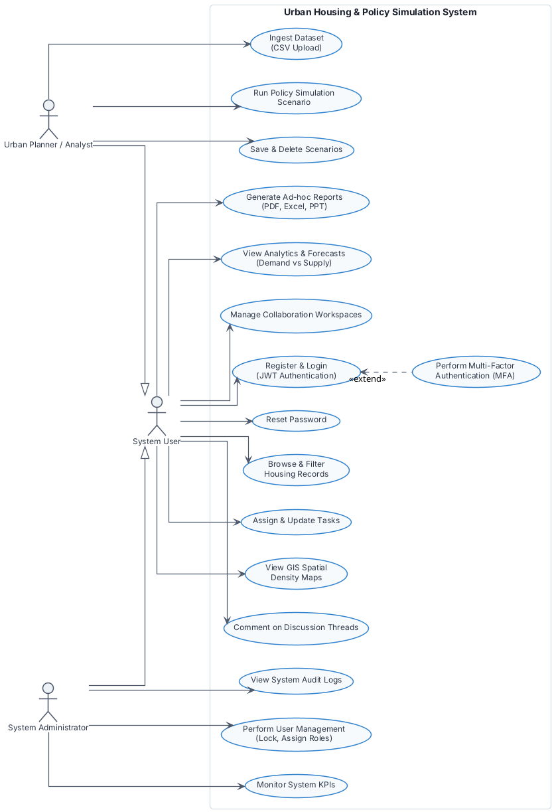
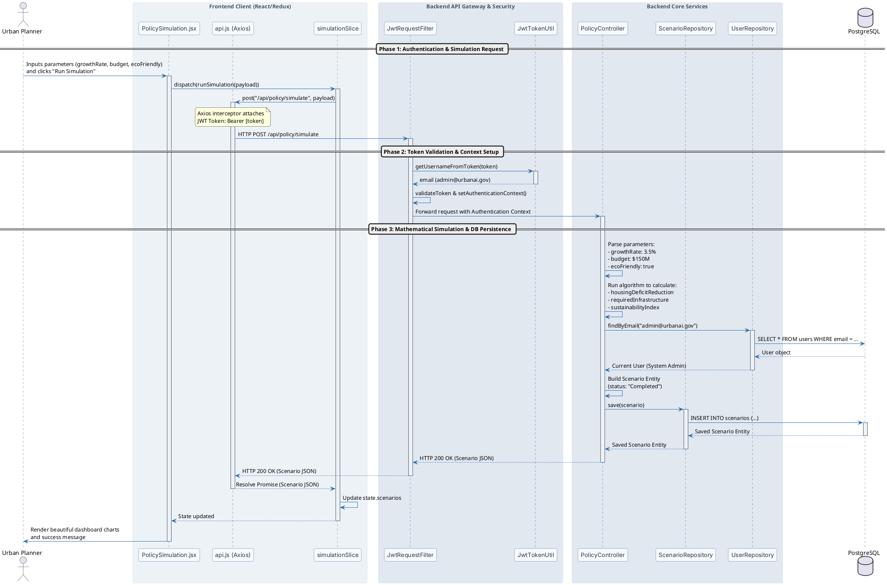
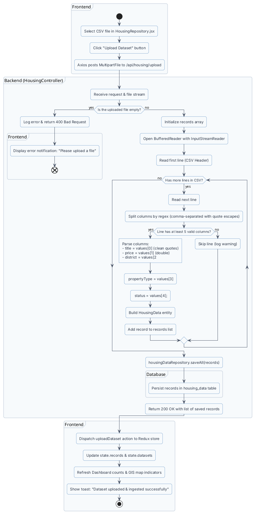
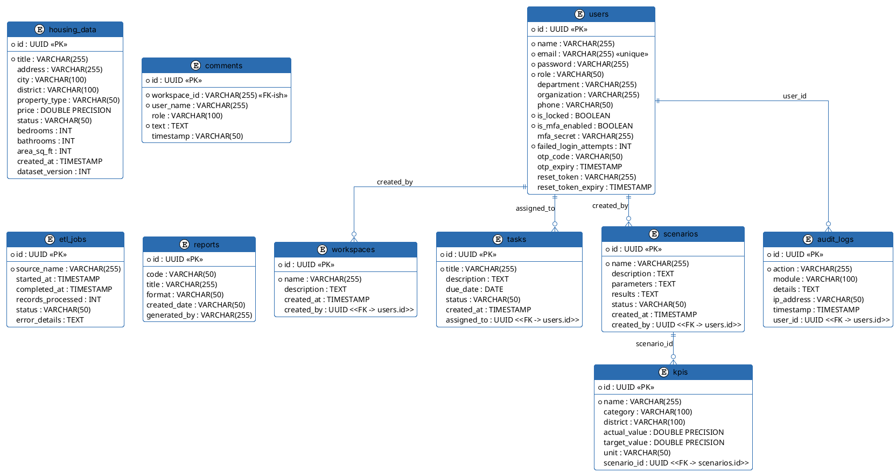
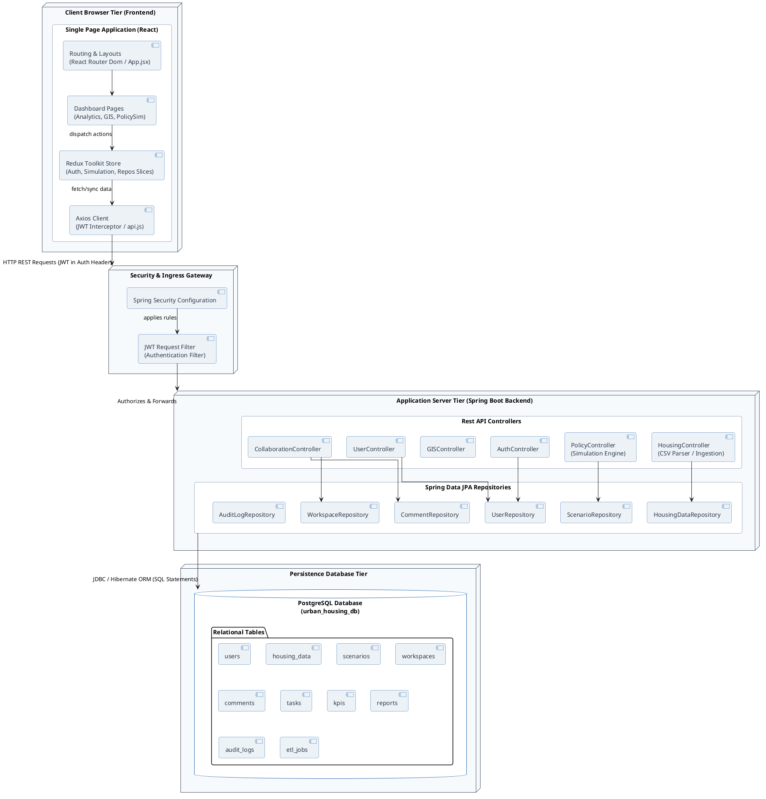

```plantuml
@startuml "Class Diagram"
skinparam linetype ortho
skinparam roundcorner 8
skinparam shadowing false
skinparam handwritten false

skinparam Class {
    BackgroundColor #F7FAFC
    BorderColor #2B6CB0
    BorderThickness 1.5
    HeaderBackgroundColor #2B6CB0
    HeaderFontColor #FFFFFF
    FontColor #2D3748
    FontSize 11
    AttributeFontSize 9
    MethodFontSize 9
}

skinparam Package {
    BackgroundColor #EDF2F7
    BorderColor #A0AEC0
}

skinparam Arrow {
    Color #4A5568
    Thickness 1.2
}

package com.urban.housing.entity {
    class User {
        + UUID id
        + String name
        + String email
        + String password
        + String role
        + String department
        + String organization
        + String phone
        + boolean isLocked
        + boolean isMfaEnabled
        + String mfaSecret
        + int failedLoginAttempts
        + String otpCode
        + LocalDateTime otpExpiry
        + String resetToken
        + LocalDateTime resetTokenExpiry
    }

    class HousingData {
        + UUID id
        + String title
        + String address
        + String city
        + String district
        + String propertyType
        + Double price
        + String status
        + Integer bedrooms
        + Integer bathrooms
        + Integer areaSqFt
        + LocalDateTime createdAt
        + Integer datasetVersion
        + Integer getUnits()
        + Double getVacancyRate()
        + String getLastUpdated()
    }

    class Workspace {
        + UUID id
        + String name
        + String description
        + LocalDateTime createdAt
        + User createdBy
        + String getOwner()
        + Integer getMembers()
    }

    class Comment {
        + UUID id
        + String workspaceId
        + String user
        + String role
        + String text
        + String timestamp
    }

    class Task {
        + UUID id
        + String title
        + String description
        + LocalDate dueDate
        + String status
        + LocalDateTime createdAt
        + User assignedTo
    }

    class Scenario {
        + UUID id
        + String name
        + String description
        + String parameters
        + String results
        + String status
        + LocalDateTime createdAt
        + User createdBy
    }

    class Kpi {
        + UUID id
        + String name
        + String category
        + String district
        + Double actualValue
        + Double targetValue
        + String unit
        + Scenario scenario
    }

    class EtlJob {
        + UUID id
        + String sourceName
        + LocalDateTime startedAt
        + LocalDateTime completedAt
        + Integer recordsProcessed
        + String status
        + String errorDetails
    }

    class Report {
        + UUID id
        + String code
        + String title
        + String format
        + String createdDate
        + String generatedBy
    }

    class AuditLog {
        + UUID id
        + String action
        + String module
        + String details
        + String ipAddress
        + LocalDateTime timestamp
        + User user
    }
}

package com.urban.housing.repository {
    interface UserRepository
    interface HousingDataRepository
    interface WorkspaceRepository
    interface CommentRepository
    interface TaskRepository
    interface ScenarioRepository
    interface KpiRepository
    interface EtlJobRepository
    interface ReportRepository
    interface AuditLogRepository
}

package com.urban.housing.controller {
    class AuthController {
        + ResponseEntity login(LoginRequest)
        + ResponseEntity register(RegisterRequest)
        + ResponseEntity refresh(String)
        + ResponseEntity resetPassword(String, String)
    }

    class HousingController {
        + ResponseEntity getHousingData(String)
        + ResponseEntity uploadDataset(MultipartFile, String)
    }

    class PolicyController {
        + ResponseEntity getAllScenarios()
        + ResponseEntity runSimulation(Map, Authentication)
        + ResponseEntity getSimulationResult(UUID)
        + ResponseEntity deleteScenario(UUID)
    }

    class CollaborationController {
        + ResponseEntity getWorkspaces()
        + ResponseEntity createWorkspace(Map, Authentication)
        + ResponseEntity getComments(String)
        + ResponseEntity createComment(Map, Authentication)
    }
}

' Entity relationships
Workspace "0..*" --> "1" User : createdBy
Task "0..*" --> "1" User : assignedTo
Scenario "0..*" --> "1" User : createdBy
Kpi "0..*" --> "1" Scenario : scenario
AuditLog "0..*" --> "1" User : user

' Controller dependencies on Repositories
AuthController ..> UserRepository
HousingController ..> HousingDataRepository
PolicyController ..> ScenarioRepository
CollaborationController ..> WorkspaceRepository
CollaborationController ..> CommentRepository

@endum
```

# Urban Housing Analysis & Policy Simulation System
## UML Design & Architecture Diagrams (PlantUML)

This document contains a set of 6 professionally styled and syntactically validated **PlantUML** diagrams that accurately map out both the **Frontend** and **Backend** architectures of your Final Year Project. Each diagram includes modern, cohesive styling matching enterprise software design standards.

---

## 1. Use Case Diagram
### Description
This diagram describes the functional requirements and system boundaries. It highlights the relationships between user roles (**System Administrator**, **Urban Planner/Analyst**, and **System User**) and the core features they interact with:
*   **Authentication & MFA**: Secured JWT-based login, MFA, and password recovery.
*   **Ingestion & Data Management**: Uploading and parsing CSV datasets, filtering housing records.
*   **Policy Simulation**: Executing custom policy parameters, calculating growth/sustainability indices, and persisting scenarios.
*   **Collaboration & Auditing**: Sharing workspaces, active discussion threads, task delegation, and monitoring administrative logs.

### PlantUML Code

---

## 2. Class Diagram
### Description
This diagram represents the structural architecture of the **Spring Boot backend** package namespaces (`entity`, `repository`, `controller`). It shows:
1.  **JPA Entities**: All data models (`User`, `HousingData`, `Workspace`, `Scenario`, `Kpi`, etc.) with their variables, annotations, custom logic methods, and relationships.
2.  **Spring Data JPA Repositories**: Interfaces extending database persistence functions.
3.  **Controllers**: Rest API entry points handling user requests, file uploads, and simulation calculations.
4.  **Relationships**: Strong associations (`createdBy`, `assignedTo`) and dependency flows mapping how components bind together.

### PlantUML Code

---

## 3. Sequence Diagram (Policy Simulation)
### Description
This sequence diagram shows the step-by-step transaction flow when an **Urban Planner** executes a **Policy Simulation**. It traces:
1.  **Frontend trigger**: Captures parameters and dispatches a Redux store action.
2.  **API Gateway & Security**: Attaches the JWT Bearer token via Axios interceptors, validates it through the `JwtRequestFilter` on the backend, and loads the user identity.
3.  **Simulation Engine & Persist**: Calculates the values (`deficit`, `infrastructure cost`, `sustainability index`), builds the entity, and saves it to the **PostgreSQL** database.
4.  **UI Feedback**: Sends the persisted JSON entity back to update the React state and update dynamic analytical graphs.

### PlantUML Code

---

## 4. Activity Diagram (Data Ingestion & CSV ETL)
### Description
This diagram maps out the transactional workflow of the **ETL (Extract, Transform, Load)** pipeline when uploading external CSV housing data. It displays conditional checkpaths (e.g. empty file error checks), parsing loops, database transactions, and final UI rendering.

### PlantUML Code

---

## 5. Database Diagram (ERD)
### Description
An exact schema representation of your **PostgreSQL** relational database. It charts:
*   Primary Keys (PK) and Foreign Keys (FK).
*   Data Types (`UUID`, `VARCHAR`, `DOUBLE PRECISION`, `TIMESTAMP`, `BOOLEAN`, `TEXT`).
*   Database Table Constraints (e.g. Unique emails).
*   Relational Cardinality (one-to-many relationships matching JPA annotations).

### PlantUML Code

---

## 6. System Architecture Design
### Description
A multi-tier architecture mapping showing how client-side components interact with secure gateway boundaries and persistent backend micro-segments:
1.  **Client Browser Tier (Frontend)**: Structured React application, using Redux slices to coordinate localized data state, and Axios to pipe outbound HTTP calls.
2.  **Ingress & Security Gateway**: Intercepts REST boundaries, using Spring Security filters to process stateless JWT tokens and block unauthenticated operations.
3.  **Application Service Tier**: Handles all computational calculations, file reads, and session processing.
4.  **Database Tier (Persistence)**: A PostgreSQL server containing individual tables seeded with municipal data.

### PlantUML Code

